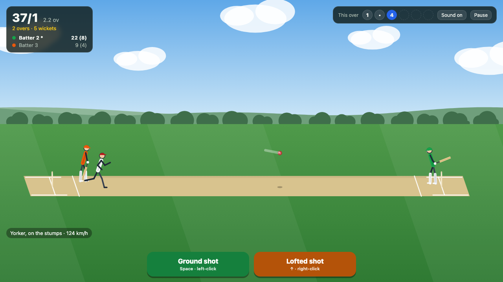
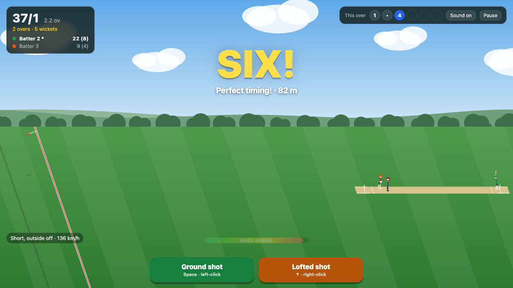

# Stickman Cricket

A small batting game you can play in any web browser. There's nothing to install and it has no dependencies.

You bat against a bowler. Fielders aren't drawn on screen. Instead, how hard you hit the ball (your timing) decides the result:

| Shot | Weak | Medium | Good | Middled |
|---|---|---|---|---|
| **Ground shot** (`Space` / left-click) | dot ball | 1 or 2 runs | 3 runs | **FOUR** |
| **Lofted shot** (`↑` / right-click) | usually **caught** | sometimes 2 runs | four (one bounce) | **SIX** |

If you miss a ball that's heading for the stumps, you're **bowled**. A thin edge outside off stump can be **caught behind**.

Before each match you can choose overs (1/2/5/10), wickets (1/3/5/10), bowling speed (Gentle/Medium/Fast), and a mode: **Free hit** or **Chase a target**.
Other keys: `P` / `Esc` pauses and `M` turns sound on or off. The game also works with touch, using the two buttons at the bottom.

## Play it on any laptop

**Option 1: just open it.** Download or clone this repo and double-click `index.html`. It runs offline in Chrome, Edge, Safari or Firefox.

**Option 2: install it as an app (from GitHub Pages).**
1. In the repo on GitHub, go to **Settings → Pages**, set the source to the `main` branch with the `/ (root)` folder, and save.
2. Open `https://<your-username>.github.io/stickman-cricket/` in Chrome or Edge.
3. Click the **Install** icon in the address bar. The game then gets its own window and desktop icon, and it works offline.

## Files

- `index.html`: the page, the HUD and the menus
- `game.js`: the game itself (physics, drawing, scoring)
- `manifest.webmanifest`, `sw.js`, `icon.svg`: what makes it installable and able to run offline
- `screenshots/`: reference images

To get a screenshot of a particular moment, add `?snap=loft&at=5.9&seed=5&len=Short` to the URL. This simulates the game up to that time and then freezes the frame.
